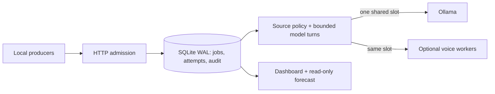
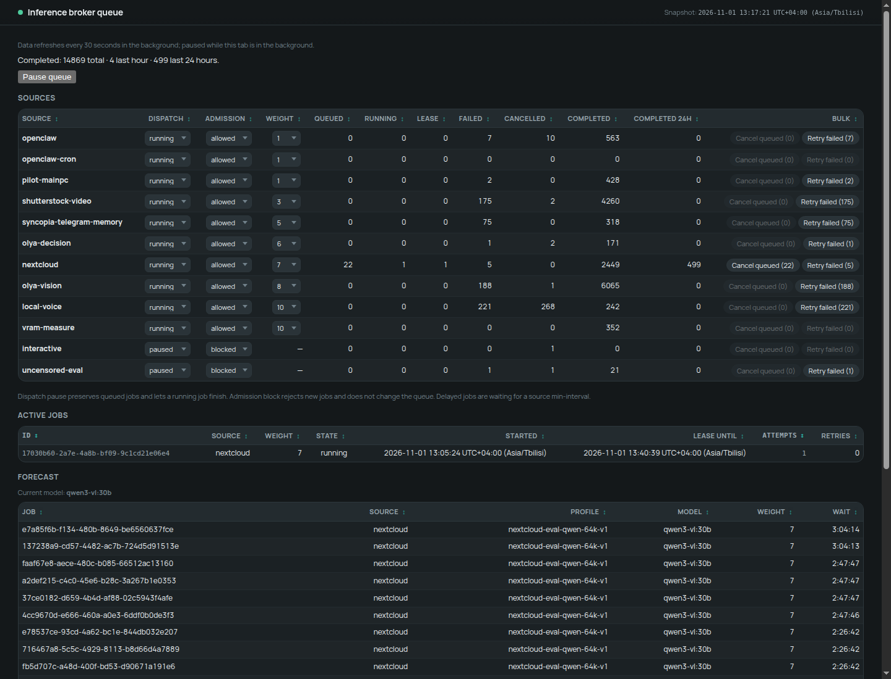

# Inference broker queue

[English](#english) · [Русский](#russian)

<a id="english"></a>
## English

A local admission and scheduling service with a durable SQLite WAL queue.
Ollama and optional voice executors share one non-preemptive execution slot.
The broker owns admission, leases, retry/cancellation records, source policy,
GPU custody fences and operational views; it does not replace the backends.



The queue stays on an always-on host; a configured executor may sleep.
Wake-on-LAN, readiness checks and inference happen only when an eligible job
is dispatched. `GET /healthz` does not contact the executor.

### Scheduling and controls

With a source policy, the recurring 60-minute **execution-time** horizon is
allocated in inverse proportion to positive weights:
`share(source) = (1 / weight) / sum(1 / weight)`.
A smaller numeric weight means more time, not less. Each source gets one
aggregate budget, regardless of how many models it uses. New ready sources
share the remaining horizon. Without a policy, eligible jobs use global FIFO.

Within a source, jobs for the same actual model share a FIFO lane across
compatible profiles. Competing model turns rotate at the next claim boundary
after 10 attempts, 300 charged seconds, or a 600-second competitor wait,
or when the current lane becomes ineligible. Running jobs are never interrupted;
these are rotation triggers, **not** per-job latency guarantees.
At a model-turn boundary, an eligible, equal-weight source with unspent budget
may continue the same model, reducing switches without borrowing another
source's share or bypassing the owner gate.
See [source/model scheduling](docs/SOURCE-MODEL-BATCHING.md).

**Pause queue** persists in SQLite, keeps admission open and stops new dispatch.
A running job finishes naturally; model unload failures are retried without
resuming dispatch. **Resume queue** re-enables dispatch. Per-source
`enabled=false` pauses dispatch; `admission_allowed=false` blocks new admission.
Neither control preempts running work.

### Dashboard and forecast

`/dashboard` shows Sources, Active jobs, Forecast and paged History. It refreshes
in the background every 30 seconds, suppresses hidden-tab refreshes and
serializes concurrent reads. Read-only observers use bounded WAL snapshots;
timeout or unavailable data is reported honestly, not as fabricated zeroes.
Model columns distinguish requested, observed and profile-default identity.

Forecast uses one conditional scenario for all sources, normally up to 10
selections (maximum 20). When Nextcloud's
external owner gate participates, a local queue snapshot cannot prove the live
global order. The API instead labels a **conditional scenario** based on the
last committed owner observation, or excludes Nextcloud explicitly. It stops
when a fresh owner check is needed and lists local unranked candidates separately;
those candidates are not guaranteed eligible. Source-interval boundaries also
stop the scenario for a fresh eligibility check.
Pause/fence holds and observation age remain visible; a scenario is neither a
lease nor an ETA promise. See [forecast](docs/FORECAST.md) and
[dashboard](docs/DASHBOARD.md).

Illustrative dashboard layout (older screenshot; labels may differ from current code):



### Local start: admission only

Python 3.11+; the core broker and unit tests use the standard library. Configure
your own executor URL and Wake-on-LAN MAC in an **untracked**, owner-only file.
There is no implicit localhost executor fallback.

```sh
cp config/local.example.json config/local.json
# Edit the executor URL and MAC before starting.
chmod 600 config/local.json
BROKER_LOCAL_CONFIG=./config/local.json BROKER_DISPATCH_ENABLED=false BROKER_DB=./broker.sqlite3 python3 -m broker
```

From another terminal: `curl --fail http://127.0.0.1:8088/healthz`.
The default bind is `127.0.0.1:8088`. Legacy job/control APIs are **not a public
authentication boundary**: keep them on a trusted local interface. Opt-in
producer-storage and ASR APIs have their own token contracts; they do not
secure the whole HTTP server.

`BROKER_DISPATCH_ENABLED=true` enables dispatch. Without a source policy,
`BROKER_DISPATCH_SOURCES` must explicitly allow sources. With
`BROKER_SOURCES_POLICY`, only enabled policy sources dispatch. For example:

```json
{"version":1,"sources":{"interactive":{"enabled":true,"admission_allowed":true,"weight":2},"cron":{"enabled":true,"admission_allowed":true,"weight":1}}}
```

This is a synthetic policy, not a production configuration.

### systemd templates

The units in `systemd/` require a checkout at
`~/.local/share/ollama-inference-broker` and private configuration outside it.
Installing unit files alone fails with systemd `CHDIR`.

```sh
mkdir -p "$HOME/.local/share" "$HOME/.config/ollama-inference-broker" "$HOME/.config/systemd/user"
git clone https://github.com/dankarization/inference-broker.git "$HOME/.local/share/ollama-inference-broker"
cd "$HOME/.local/share/ollama-inference-broker"
cp config/local.example.json "$HOME/.config/ollama-inference-broker/local.json"
# Edit the executor URL and MAC, then keep all local configuration private.
chmod 600 "$HOME/.config/ollama-inference-broker/local.json"
touch "$HOME/.config/ollama-inference-broker/broker.env"
chmod 600 "$HOME/.config/ollama-inference-broker/broker.env"
cp systemd/ollama-inference-broker*.service systemd/ollama-inference-broker-report.timer "$HOME/.config/systemd/user/"
systemctl --user daemon-reload
```

The broker template leaves dispatch disabled. Both broker and reporter read
`~/.config/ollama-inference-broker/local.json`; `BROKER_LOCAL_CONFIG` overrides
that path. `OLLAMA_URL` and `MAINPC_MAC` override broker values;
`BROKER_OLLAMA_URL` overrides the reporter URL. Set `WOL_BROADCAST` if needed.

The report timer is optional: copy `config/report.env.example` to the private
configuration directory as `report.env`, replace placeholders and use mode 0600.
`OPENCLAW_CONFIG_PATH` selects an existing OpenClaw JSON containing the Telegram
account token; `BROKER_REPORT_TELEGRAM_ACCOUNT` defaults to `default`.
The report unit reads `broker.env` before `report.env` and shares the broker's
`BROKER_SOURCES_POLICY` unless overridden. Never put tokens or live data in Git.

A lossless dispatcher drain uses `systemctl --user reload ollama-inference-broker.service`,
which signals only MainPID. Do not use `systemctl --user kill -s SIGUSR1`:
it can signal an active inference child too. Deployment, restart, migrations
and live control changes are separate operator actions, not effects of a Git update.

### API and optional contracts

- [HTTP API](docs/API.md): `POST /v1/jobs` returns durable HTTP 202 admission;
  status/cancel endpoints expose lifecycle. `/api/chat` and `/api/generate`
  are admission-compatible endpoints, **not** direct streaming proxies.
- [OpenClaw native route](docs/OPENCLAW_ROUTE.md): opt-in queued synchronous
  chat with an Ollama-compatible final response, separate from legacy admission.
- [Nextcloud](docs/NEXTCLOUD.md): source-local new-upload priority, queued-only
  idempotent promotion and an optional restricted external owner gate. The gate
  needs separately installed `psycopg` and an external PostgreSQL contract; core
  startup without `BROKER_NEXTCLOUD_PRIORITY_FILE` does not require either.
- [Native summaries](docs/syncopia-summary-native-v1.md): two opt-in, digest-pinned
  Gemma/Bolt profiles with explicit budgets and Boolean `think=false`.
  Legacy memory/daily/nightly contracts remain separate.
- [Voice jobs](docs/VOICE-JOBS.md), [Whisper ASR](docs/WHISPER_EXECUTOR.md),
  [CPU segments](docs/VOICE-CPU-SEGMENTS.md) and
  [diarization wire contract](docs/DIARIZATION.md): optional executors need
  matching workers, explicit private configuration and existing GPU custody.
- [Producer storage](docs/PRODUCER_STORAGE.md) and [analytics](docs/ANALYTICS.md):
  opt-in owner-token APIs, durable receipts and guarded compaction.

**Release boundary:** this tree includes broker-side diarization admission and
validation, not a bundled diarization worker or proof of model quality/E2E
readiness. Later acoustic OGG/MP3/FLAC protocol extensions and atomic local-voice
hold work from separate feature branches are not included in this sync. Do not
infer availability from a branch name or opt-in profile alone. See
[ROADMAP](ROADMAP.md) for additional historical boundaries; private deployment
receipts, production configuration and working data are intentionally not shipped.

### Validation

```sh
PYTHONDONTWRITEBYTECODE=1 python3 -m unittest discover -s tests -v
node tests/dashboard_dom.cjs
# Optional real-browser test: uses existing Chromium and Python websockets.
PYTHONDONTWRITEBYTECODE=1 PYTHONPATH=. python3 tests/browser_dashboard.py
```

Tests use synthetic data and fake inference/WOL; no live backend is required.
Three cross-project ASR contract tests skip unless `STT_SOURCE_ROOT` points to a
compatible worker checkout. The browser test is optional, not a core dependency.

---

<a id="russian"></a>
## Русский

Локальный брокер хранит задания в SQLite WAL и последовательно исполняет их
через Ollama либо дополнительные voice workers. Общие очередь, leases,
ограждения GPU и source policy сохраняются; наличие профиля не устанавливает
worker и не доказывает готовность его модели.

С policy каждый source получает **один** бюджет времени исполнения обратно
пропорционально весу: меньший положительный вес означает большую долю.
Количество моделей внутри source не умножает эту долю. Совместимые профили
одной фактической модели образуют FIFO lane; конкурирующие модели сменяют
друг друга на границе claim после 10 попыток, 300 секунд текущего turn либо
600 секунд ожидания конкурента. Текущее задание не прерывается; это не SLA.
На границе model turn другой source с тем же весом и остатком собственного
бюджета может продолжить ту же модель, не обходя eligibility и owner gate.
Без policy действует глобальный FIFO.

**Pause queue** сохраняется после рестарта, запрещает новые запуски, но не
приём; текущая работа завершается естественно. **Resume queue** возобновляет
запуски. Admission block и dispatch pause конкретного source независимы.

Dashboard показывает запрошенную и наблюдаемую модель, обновляется в фоне и
подгружает History страницами. Forecast — единый условный сценарий всех source,
не очередь leases:
при участии внешнего Nextcloud owner gate отдельно показаны сценарий,
давность наблюдения, неранжированные кандидаты и необходимость нового gate read.
Неранжированный кандидат не считается допущенным к выполнению. На границе
интервала source сценарий останавливается до следующей проверки eligibility.
При паузе сценарий применим только после resume; точный ETA не обещается.

Для локального запуска используйте [admission-only пример](#local-start-admission-only),
а для units — [systemd templates](#systemd-templates). Нужен Python 3.11+;
адреса исполнителей, MAC и токены задаются только в приватной конфигурации.
Legacy HTTP API нельзя выставлять в недоверенную сеть. Обновление Git не
развёртывает код, не перезапускает сервис и не меняет live controls.

Подробные контракты и команды проверки — в английском разделе выше.
Broker-side diarization уже присутствует в этом дереве; worker поставляется
отдельно. Неизданные расширения акустического протокола и atomic local-voice
hold из других веток намеренно не добавлены. Скриншот иллюстративный, не
свидетельство текущего production. Публикуемые исходники не включают private
rollout proofs, рабочие payload или live-конфигурацию.
